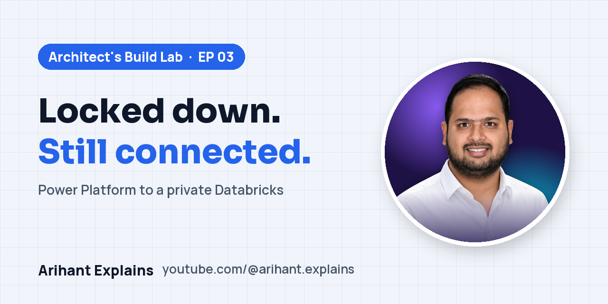
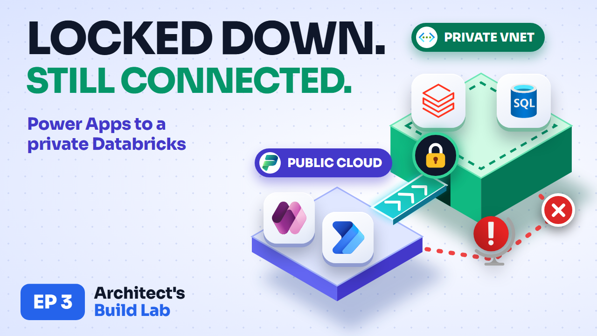
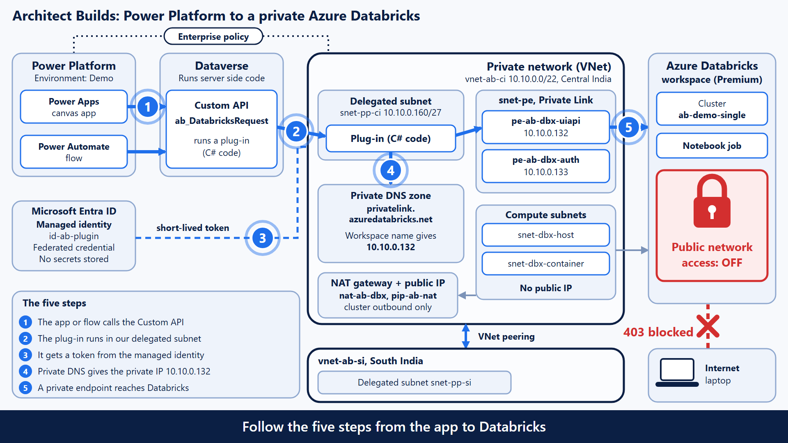
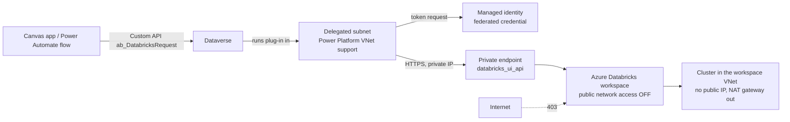

<p align="center">
  
</p>

# build-lab-ep03-private-databricks

**Architect's Build Lab, Episode 3: Power Apps and Power Automate calling an Azure Databricks workspace that has public network access switched off**

> Security switched off public access on the Databricks workspace. The business app still has to start a job and read the result. This repo is the full build that makes both true at the same time.

[](LICENSE)
[](https://learn.microsoft.com/power-platform/)
[](https://learn.microsoft.com/power-apps/maker/data-platform/)
[](https://learn.microsoft.com/azure/databricks/)
[](https://learn.microsoft.com/azure/databricks/security/network/concepts/privatelink-concepts)
[](https://learn.microsoft.com/power-platform/admin/vnet-support-overview)
[](https://learn.microsoft.com/power-platform/admin/set-up-managed-identity)
[](plugin/DatabricksPrivatePlugin/DatabricksPrivatePlugin.csproj)

## What this is and why

Many companies keep their data platform fully private: no public endpoint, nothing reachable from the internet.
That is good for security, but it breaks the usual way a Power App or a flow talks to Databricks, because there is no public door left to call.
This repo connects the two anyway: a Dataverse plug-in runs inside your own network through Power Platform VNet support, reaches the workspace over Private Link, and signs in with a managed identity, so no secret is stored anywhere.

## Watch the video

<!-- VIDEO: -->
[](https://youtu.be/RI6cb9neoEA)

**Watch on YouTube:** https://youtu.be/RI6cb9neoEA (36 minutes: a first look at the architecture, every term explained, the full build in the Azure portal, the C# code part by part, the demo and the common mistakes)

## What it achieves

One button in a canvas app, and this happens:

1. The app calls the Custom API `ab_DatabricksRequest` with an operation, for example `submitJob`.
2. Dataverse checks that the user may call the Custom API, then runs the plug-in inside your delegated subnet.
3. The plug-in asks the platform for a short-lived Microsoft Entra token for the managed identity. No secret, no personal access token.
4. The workspace name resolves to a private IP (Private Link + private DNS), so the call never leaves your network.
5. Databricks starts the cluster or runs the notebook and the app shows the result, for example `SUCCESS` and the summary rows.
6. The same workspace URL called from the internet answers **403**, because public network access is off.

## Architecture

<p align="center"></p>



More detail, the sequence of one call and the design choices: [docs/ARCHITECTURE.md](docs/ARCHITECTURE.md).

## Operations

The Custom API takes `Operation` and an optional `Payload`, and returns `Status` and `Result` (JSON).

| Operation | Payload | What it does |
|---|---|---|
| `whoAmI` | none | Shows who Databricks thinks we are: the managed identity |
| `dnsCheck` | none | Resolves the workspace host from inside the subnet and says if every address is private |
| `listClusters` | none | Lists the clusters this identity has permission on |
| `startCluster` | none | Starts the demo cluster (returns `Starting` or `AlreadyRunning`) |
| `submitJob` | row count, 1 to 1,000,000 | Submits a one time notebook run, returns the run id at once |
| `runStatus` | run id | Polls the run and returns the notebook output when it has finished |

Long work is always **submit, then poll**, so the plug-in stays far below the 2 minute sandbox limit.

## Folder map

```text
plugin/DatabricksPrivatePlugin/   the Dataverse plug-in (C#, .NET Framework 4.6.2)
databricks/summary.py             the demo notebook (synthetic data, returns JSON)
app/                              the canvas app source (Power Apps YAML)
config/                           sample value for the environment variable ab_DatabricksConfig
scripts/                          Azure CLI and Dataverse Web API steps, in build order, plus config.sample.ps1
docs/                             architecture, setup, permissions, security, build checklist, glossary
```

## Prerequisites

- An Azure subscription where you can create resources, and the Azure CLI
- A Power Platform **developer or demo** environment that can be a Managed Environment (VNet support needs it)
- Power Platform CLI (`pac`), the Plugin Registration Tool, and the .NET SDK
- Two regions of your Power Platform geography for the enterprise policy (the video uses Central India and South India)
- A Premium Azure Databricks workspace (Private Link does not work on the Trial tier)

## Setup in a demo environment

The short version is below. The full step by step guide, with a check after every step, is [docs/setup.md](docs/setup.md), and the printable build order is [docs/checklist.md](docs/checklist.md).

1. Copy `scripts/config.sample.ps1` to `scripts/config.ps1`, fill in your values, and dot-source it.
2. Network: VNets and subnets, NAT gateway, private DNS zone, private endpoints, VNet peering (`scripts/01` to `06`).
3. Identity: user assigned managed identity, sign the plug-in, federated credential (`scripts/07`, `08`).
4. Power Platform: enterprise policy, Managed Environment, link the policy (`scripts/09` to `12`).
5. Dataverse: register the assembly, managed identity record, Custom API, trace log (`scripts/13`, `14`), and the environment variable `ab_DatabricksConfig`.
6. Databricks: import the notebook, add the identity as a service principal, create a small cluster, grant **Can Restart** and notebook access.
7. Switch **public network access off** on the workspace and prove it: 403 from outside, a private IP from `dnsCheck`, and `SUCCESS` from the app.

## Permissions (least privilege)

| Who | Gets | Why |
|---|---|---|
| Managed identity (as a Databricks service principal) | **Can Restart** on one demo cluster | To start it, nothing more |
| Managed identity | Read and run on the demo notebook | To submit the notebook run |
| App users | Permission to call the Custom API | Dataverse checks this before the plug-in runs |
| Plug-in | Reads one environment variable | URL, cluster id and notebook path only, no secrets |

Details and what was left out on purpose: [docs/permissions.md](docs/permissions.md).

## Security model

| Guardrail | Where it lives |
|---|---|
| No public door: public network access is Disabled | Databricks workspace networking |
| Private path only: private endpoint + private DNS zone | `scripts/04`, `scripts/05` |
| No secret anywhere: managed identity with a federated credential bound to the signed assembly and the environment | `scripts/07`, `scripts/08`, `GetDatabricksToken` |
| The plug-in only talks to `https://*.azuredatabricks.net` | `DemoConfig.Load` |
| Input checks on every operation (allowed names, row count range, numeric run id) | `DatabricksGatewayPlugin` |
| Time limits: 30 s per call, 90 s per plug-in run | `DatabricksClient`, `DatabricksGatewayPlugin` |
| The token is never written to the trace log, only its length | `GetDatabricksToken` |

Known limits are listed honestly in [docs/security.md](docs/security.md).

## Troubleshooting

| You see | Likely cause | Fix |
|---|---|---|
| `IManagedIdentityService is not available. Link a managed identity record to this plug-in assembly.` | The assembly has no managed identity record | Run `scripts/14`, check `_managedidentityid_value` on the assembly |
| `AADSTS700213` in the trace log | The federated credential subject does not match | The certificate hash must be lowercase HEX, see `scripts/tools/fic-subject.ps1` |
| `Databricks did not answer within 30 s. Is the private endpoint and DNS in place?` | The name resolves to a public IP, or the policy is not linked | Run `dnsCheck`, check the DNS zone links and `scripts/12-linked-proof.ps1` |
| `Databricks returned 403 (...)` | The identity is not in the workspace, or has no permission | Add the service principal, grant Can Restart and notebook access |
| `Only premium workspaces can create private endpoint connection` | Trial or Standard tier | Use the Premium tier |
| `workspaceUrl must be https://<workspace>.azuredatabricks.net` | Wrong value in the environment variable | Fix `ab_DatabricksConfig`, see `config/` |
| `Environment variable ab_DatabricksConfig is missing.` | The variable was not created in this environment | Create it, see [docs/setup.md](docs/setup.md) |

## FAQ

**Why a plug-in and not the Databricks connector?** The plug-in is the piece that runs inside your delegated subnet through VNet support, so it can reach a workspace that has no public access.

**Why two VNets?** The enterprise policy needs a delegated subnet in each region of the environment's geography. The second VNet is small and joined with peering.

**Does this need a client secret or a personal access token?** No. The managed identity gets a short-lived token through a federated credential. There is nothing to rotate.

**Will it work with a Standard workspace?** No, Private Link needs Premium.

**Can I use this in production as is?** Treat it as a teaching sample. Read [SECURITY.md](SECURITY.md) and [docs/security.md](docs/security.md) first, and use a properly issued code signing certificate instead of the demo self-signed one.

## Credits

Built and explained by **Arihant Jain**, Solution Architect with nearly 15 years of experience building business apps, automation and AI solutions with Microsoft technologies.
YouTube: [Arihant Explains](https://www.youtube.com/@arihant.explains). More episodes in the [Architect's Build Lab playlist](https://www.youtube.com/playlist?list=PLAts8F4bMzpY).

## License

[MIT](LICENSE). Microsoft, Power Apps, Power Automate, Dataverse and Azure are trademarks of the Microsoft group of companies. Databricks is a trademark of Databricks, Inc. Product names are used for education.
