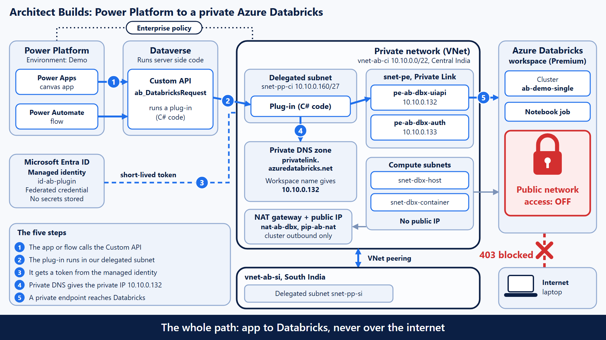
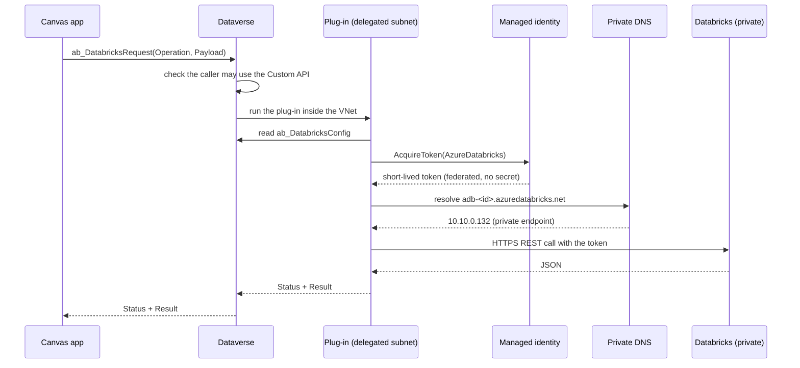
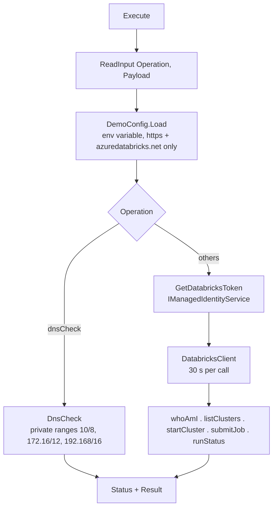

# Architecture

## The pieces

| Piece | Lives in | Job |
|---|---|---|
| Canvas app and flow | Power Platform environment | Call the Custom API with an operation |
| Custom API `ab_DatabricksRequest` | Dataverse | The one door the app and the flow use. Dataverse checks the caller first |
| Plug-in `DatabricksGatewayPlugin` | Runs in the delegated subnet through VNet support | Reads the settings, gets a token, calls the Databricks REST API |
| Environment variable `ab_DatabricksConfig` | Dataverse | Workspace URL, cluster id, notebook path. No secrets |
| Enterprise policy `ep-ab-vnet` | Azure, linked to the environment | Tells Power Platform which delegated subnets to use, one per region |
| Managed identity `id-ab-plugin` + federated credential | Azure | The identity the plug-in becomes. Trusts only this signed assembly in this environment |
| Private endpoints + private DNS zone | `snet-pe` in `vnet-ab-ci` | Give the workspace a private IP inside our network |
| Databricks workspace | VNet injection in `vnet-ab-ci`, Premium | Runs the cluster and the notebook. Public network access is Disabled |
| NAT gateway | Databricks subnets | One way exit for the cluster, no public IP on any cluster machine |
| Second VNet `vnet-ab-si` + peering | Paired region | Required by the enterprise policy |

## One call, step by step

## Inside the code

## Design choices

- **Plug-in behind a Custom API.** The plug-in is what runs inside the delegated subnet. The Custom API gives the app and the flow one clean, permission checked door with typed inputs and outputs.
- **Submit, then poll.** A notebook run can take minutes and a cluster start even longer. The plug-in only submits or reads status, so every call finishes in seconds, far below the 2 minute sandbox limit.
- **Managed identity with a federated credential.** No client secret and no personal access token to store or rotate. The credential is bound to the certificate that signed this assembly and to one environment.
- **Settings in an environment variable.** The URL and ids can change per environment through normal solution ALM, and nothing secret lives there.
- **Front end Private Link only.** The cluster reaches the control plane through secure cluster connectivity and the NAT gateway. The two private endpoints are for the REST API and browser sign in.
- **Synthetic data in the notebook.** The demo needs no storage account and no extra permissions.

## Data stored

The plug-in stores nothing. It returns JSON to the caller. The plug-in trace log keeps the operation, the host, the HTTP status codes and the timings, never the token.
